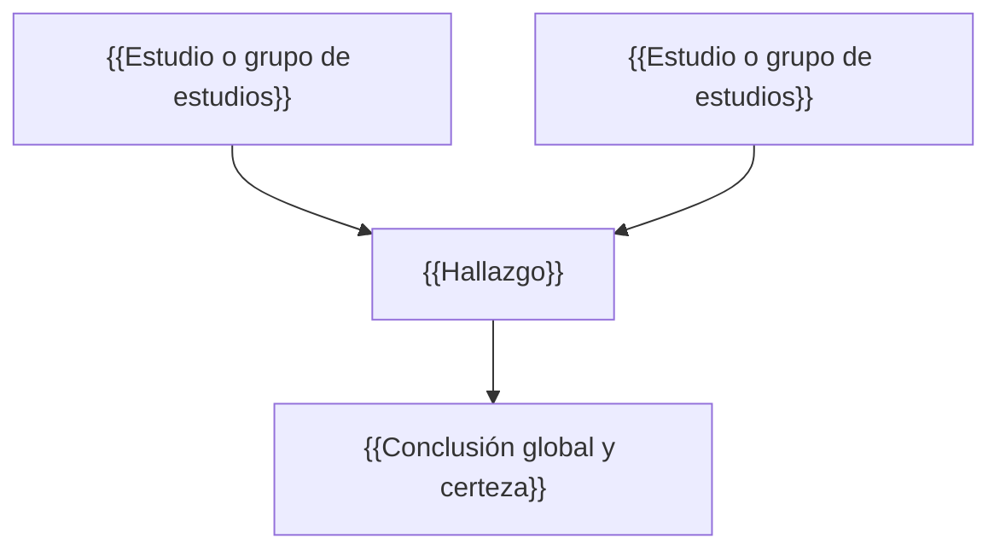

# {{Pregunta o tema del análisis}}

## 1. Resumen ejecutivo

{{5–8 líneas: la conclusión global, su magnitud y su certeza, con citas [n].}}

## 2. Estudios incluidos

| # | Estudio | Diseño | N | Población | Intervención / exposición | Desenlace principal | Resultado clave | Riesgo de sesgo |
|---|---|---|---|---|---|---|---|---|
| 1 | {{Autor, año}} | {{diseño}} | {{N}} | {{población}} | {{intervención}} | {{desenlace}} | {{efecto, IC 95 %}} | {{bajo / dudas / alto}} |
| 2 | {{Autor, año}} | {{diseño}} | {{N}} | {{población}} | {{intervención}} | {{desenlace}} | {{efecto, IC 95 %}} | {{bajo / dudas / alto}} |

## 3. Hallazgos convergentes

- {{Hallazgo sostenido por ≥2 estudios}} [{{n}}, {{m}}]

## 4. Divergencias y heterogeneidad

- {{Discrepancia}} — explicación probable: {{población / dosis / diseño / desenlace / seguimiento}} [{{n}}, {{m}}]

## 5. Certeza de la evidencia

| Desenlace | Certeza | Razón |
|---|---|---|
| {{desenlace}} | {{alta / moderada / baja / muy baja}} | {{riesgo de sesgo, inconsistencia, indirecta, imprecisión}} |

## 6. Esquema integrador

## 7. Detalles a considerar

- {{Aplicabilidad, seguridad, contexto chileno, matices que cambian la interpretación.}}

## 8. Vacíos y próximos pasos

- {{Qué no se sabe y qué estudio o búsqueda lo resolvería.}}

## Referencias

1. {{Cita Vancouver}}. doi:{{DOI}}. PMID: {{PMID}}.
2. {{Cita Vancouver}}. doi:{{DOI}}. PMID: {{PMID}}.
