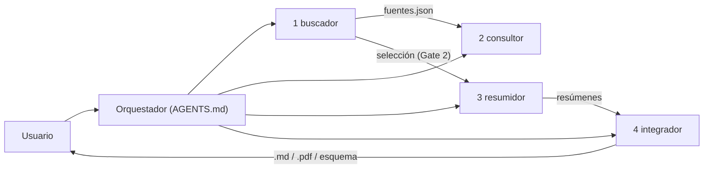

# Orquestador científico

Un orquestador **analítico, científico e integrador** que coordina 4 agentes para trabajar con
literatura científica. Corre en **Claude Code** y en **Hermes Agent** (local) con una sola
definición: `AGENTS.md` + `.claude/agents/` + `.claude/skills/` + `scripts/`.

| # | Agente | Qué hace | Entrega |
|---|---|---|---|
| 1 | `buscador` | Busca papers en PubMed, OpenAlex, Semantic Scholar y en local (carpeta, Zotero, Obsidian) | `workspace/busquedas/<slug>/` |
| 2 | `consultor` | Responde preguntas científicas con esa evidencia, citas y certeza | `workspace/respuestas/<slug>.md` |
| 3 | `resumidor` | Resume un estudio (PDF, Word, .md): ficha, resumen estructurado, ≥2 aspectos positivos y ≥2 negativos, aporte global, hallazgos destacados con página | `workspace/resumenes_papers/<autor-año-slug>.md` |
| 4 | `integrador` | Integra varios estudios: matriz, convergencias, divergencias, certeza, detalles a considerar y esquema Mermaid | `workspace/analisis_globales/<slug>.md` (+ PDF, SVG) |



## Estructura

```
AGENTS.md                 # orquestador: identidad, enrutamiento, reglas C1–C12, gates
CLAUDE.md                 # importa AGENTS.md para Claude Code
.claude/
  agents/                 # los 4 subagentes (también son el SOUL.md de cada perfil Hermes)
  commands/               # /buscar-paper /responder /resumir /analizar
  skills/                 # procedimientos + plantillas (compartidos por Claude Code y Hermes)
hermes/README.md          # instalación de los perfiles de Hermes
scripts/                  # Python: búsqueda, fuentes locales, extracción, verificación, exportación
memory/                   # context_global.md (+ logs e intermedios, no versionados)
workspace/                # entregables; papers_locales/ no se versiona
tests/                    # pytest (sin red)
```

## Instalación

```bash
python3 -m venv .venv && source .venv/bin/activate
pip install -r requirements.txt
python3 -m playwright install chromium        # para exportar PDF y para acceso-uc
mkdir -p ~/.config/harness && cp .env.example ~/.config/harness/.env && chmod 600 ~/.config/harness/.env
```

Completa `~/.config/harness/.env` (al menos `ENTREZ_EMAIL`; `OBSIDIAN_VAULT` y Zotero si los
usas). Para Zotero, deja el escritorio abierto con la API local activada
(`curl http://localhost:23119/api/` debe responder).

## Uso en Claude Code

```text
/buscar-paper myasthenia gravis efgartigimod desde 2018
/responder ¿El efgartigimod reduce el MG-ADL frente a placebo en MG generalizada AChR+?
/resumir workspace/papers_locales/howard-2021-adapt.pdf pdf
/analizar eficacia de inhibidores de FcRn en MG workspace/resumenes_papers/ pdf esquema
```

O en lenguaje natural: el orquestador enruta solo y declara a qué agente delega.

## Uso en Hermes (local)

Ver [`hermes/README.md`](hermes/README.md). En resumen:

```bash
python3 scripts/instalar_hermes.py --modelo gemma4-64k --instalar-plugin
```

```bash
orquestador chat
```

## Scripts

| Script | Ejemplo |
|---|---|
| Búsqueda remota | `python3 scripts/buscar_literatura.py "ALS riluzole survival" --n 20 --out workspace/busquedas/als-riluzol` |
| Carpeta local | `python3 scripts/fuentes_locales.py carpeta "MG-ADL" --ruta workspace/papers_locales` |
| Zotero | `python3 scripts/fuentes_locales.py zotero "complement inhibitor" --n 10` |
| Obsidian | `python3 scripts/fuentes_locales.py obsidian "fibra fina"` |
| Extraer texto | `python3 scripts/extraer_texto.py estudio.pdf --out memory/agent_handoffs/estudio.md` |
| Verificar | `python3 scripts/verificar.py workspace/resumenes_papers/x.md` |
| Exportar | `python3 scripts/exportar.py x.md --pdf x.pdf --esquemas esquemas/` |
| Proxy UC | `python3 scripts/fetch_uc_paper.py 10.1056/NEJMoa1800410 workspace/papers_locales/x.pdf` |

Google Scholar no se consulta: no tiene API oficial. OpenAlex y Semantic Scholar son los
sustitutos abiertos.

## Desarrollo

```bash
pip install -r requirements-dev.txt
ruff check . && black --check .
pytest
```

## Versión anterior

La versión 1.x (orquestador con 8 subagentes: med, research, biz, signals, coach, docs, home,
shopper; skills de domótica, docx/pptx; carpeta `projects/`) se eliminó en la 2.0.0 y queda en
el historial de git. Para recuperar algo puntual:

```bash
git checkout beb2f48 -- projects/
```
